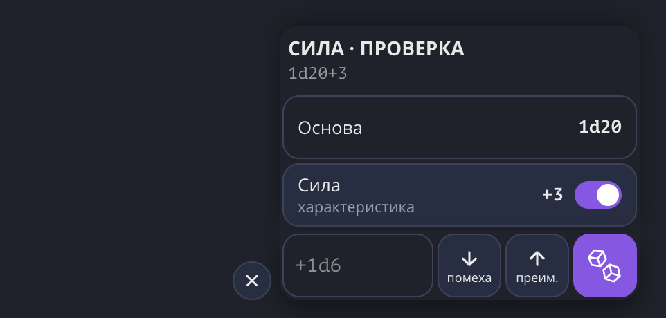

Обычный клик по проверке, атаке или урону — сразу бросок со всеми бонусами. Для частых случаев
есть клавиши, а если бросок нужно поправить, откройте его в **заряженной дайснице**.

## Клавиши на компьютере

| Клик | Что произойдёт |
|---|---|
| Shift-клик | Бросок сразу с **преимуществом** |
| Alt-клик (Option на Mac) | Бросок сразу с **помехой** |
| Ctrl-клик (Cmd на Mac) | Открыть бросок в **заряженной дайснице** |

С клавиатуры — то же с Enter: Shift+Enter, Alt+Enter, Ctrl+Enter (Cmd+Enter).

Пока клавиша зажата, по краю кнопки дайсницы в углу экрана пробегает линия её цвета: зелёная —
преимущество, красная — помеха, синяя — заряженная дайсница. Так видно, что сделает клик.

У **урона** d20 нет, поэтому Shift-клик по урону бросает его **критическим** — кости урона
удваиваются, числа нет.

**На телефоне** клавиш нет: удержание пальцем по броску открывает заряженную дайсницу, преимущество
и помеха — в ней.

## Преимущество и помеха от бонусов

Преимущество или помеху может давать сам лист: [бонус](/doc/character-sheet/bonuses/) типа ↑
или ↓, [эффект](/doc/character-sheet/effects/) вроде Ярости или
[состояние](/doc/character-sheet/effects/#состояния) вроде отравленного. Тогда:

*   **В углу кнопки броска** видна метка: ↑ — преимущество, ↓ — помеха, ↕ — источники есть с
    обеих сторон и отменяют друг друга.
*   **Обычный клик** сразу бросает с этим режимом — две d20, Shift и Alt не нужны.
*   **В логе** рядом с режимом указана причина: «помеха (Отравленный)», «преимущество (Ярость)».
*   **Число в поле не меняется** — режим влияет на бросок, а не на модификатор. Исключение —
    пассивные чувства: преимущество поднимает их на 5, помеха опускает на 5.

Режимы складываются по правилу книги: хотя бы одно преимущество и хотя бы одна помеха дают
обычный бросок, сколько бы их ни было. Shift и Alt — ещё один источник в том же правиле: Shift
при помехе от истощения даст обычный бросок, Alt при преимуществе от Ярости — тоже.

## Заряженная дайсница

*   **Бросить с преимуществом или помехой** — кнопки рядом с «Бросить». Бросаются две d20, в итог идёт
    большая или меньшая, сброшенная в логе приглушена. Кнопок нет у бросков без d20 — например, у урона.
*   **Снять часть броска.** Бросок разложен на части: основа (`1d20` или кости урона), характеристика,
    мастерство, бонусы листа с подписью, откуда они. Любую часть, кроме основы, можно выключить
    тумблером — например, Благословение, если его действие кончилось.
*   **Включить отключённый бонус.** Бонусы, выключенные в [системе бонусов](/doc/character-sheet/bonuses/),
    здесь видны снятыми: включите тумблер, чтобы бросок учёл бонус один раз. «Сбросить» снова их снимает.
*   **Докинуть** — прибавить к броску формулу: `+1d6`, `-2`, `+[PROF]`. Правила записи — в
    [нотации формул](/doc/character-sheet/notation/).
*   **Критическое попадание** — у урона: кости урона удваиваются, числа нет.
*   **Выбрать вариант урона.** Если у оружия есть выключенная [база урона](/doc/character-sheet/bonuses/#бонусы-к-урону)
    — например, `1d10` «Двуручный хват» у полуторного меча, — клик по ней бросит урон этой
    формулой вместо обычной.

Esc или клик мимо дайсницы — отмена без броска. Пока заряженная дайсница открыта, остальные проверки
бросаются обычным кликом.

Поддерживаются проверки **навыков**, **характеристик**, **спасбросков**, **инициативы**,
**атаки** оружием и заклинанием, **урон** оружия, **каст заклинания**, а также формулы в
[текстовом редакторе](/doc/text-editor/dice-roller/) — у них из частей только основа и «докинуть».

## Каст заклинания

Клавиши работают и на кнопке каста — или на ячейке, если заклинание предлагает выбрать, чем платить:

*   **Shift-клик** — атака с преимуществом, урон следом. У заклинания без броска атаки Shift-клик
    бросает урон критическим.
*   **Alt-клик** — атака с помехой.
*   **Ctrl-клик (Cmd на Mac) или удержание** — каст в заряженной дайснице по очереди: сначала атака,
    затем урон каждой части. Ячейка тратится, а каст уходит в комнату, когда брошено всё. Отмена
    на первом броске — каста нет, ячейка цела.

Если выбор ячейки открыт клавишей, обычный клик по ячейке кастует так же.

Натуральная 20 на атаке заклинанием удваивает кости урона: при обычном касте сама, в заряженной
дайснице урон откроется с уже включённым «Критическим попаданием».

## Пустая дайсница

Кнопка с d20 в углу экрана открывает дайсницу для бросков, которых на листе нет: выберите кости
и модификатор или напишите формулу. Формула с ошибкой не бросается — причина появится над полем.
